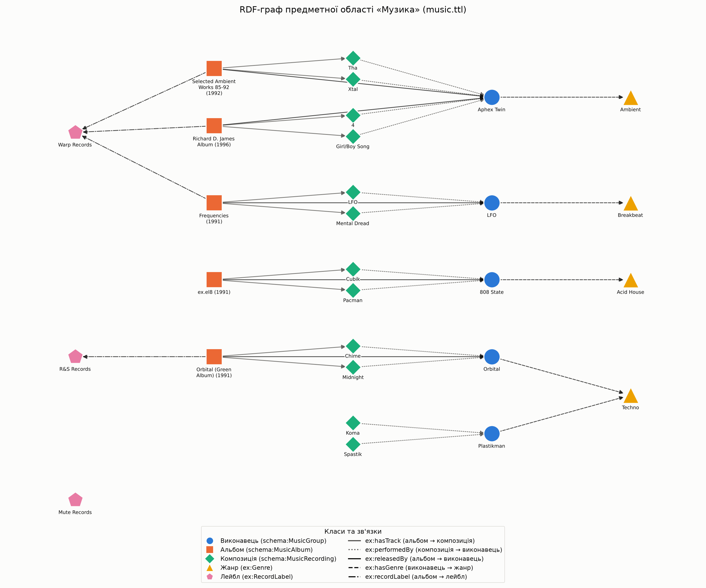

# Лабораторна робота №01. RDF та SPARQL

**Студент:** Назар Багатченко
**Тема:** музика (виконавці, альбоми, пісні, жанри, лейбли)
```

## 1. Про що граф і звідки дані

Я взяв **музику**. Дані я не брав з готових наборів, а зробив **свої**: 5 виконавців, 5 альбомів, 12 пісень, 4 жанри, 3 лейбли. Назви справжні. **Тривалість пісень (у секундах) приблизна**, це не точні дані з офіційних джерел. Для лабораторної цього досить.

Частину даних я зробив неповною навмисно, щоб запитам було що показати:

- альбом `ex.el8` без лейбла;
- лейбл Mute Records не має жодного альбому;
- у Plastikman є тільки сингли, альбомів немає;
- у Aphex Twin два альбоми, тому в Q3 є один явний лідер.

**Питання, на які має відповідати граф:**

1. Які пісні є в певному альбомі (від найдовшої до найкоротшої)?
2. Які альбоми вийшли у 1991–1992 роках?
3. Який виконавець має найбільше альбомів?
4. Яка середня тривалість пісень у кожному жанрі?
5. Які виконавці випускали тільки сингли, без альбомів?

## 2. Як побудований граф

| Що | Скільки | Скільки треба |
|---|---|---|
| Типи сутностей | 5: виконавець, альбом, пісня, жанр, лейбл | не менше 5 |
| Екземпляри | 29 (34 URI, якщо рахувати ще 5 класів) | не менше 20 |
| Типи зв'язків | 5: `ex:hasTrack`, `ex:performedBy`, `ex:releasedBy`, `ex:hasGenre`, `ex:recordLabel` | не менше 5 |
| Трійки | 140 | не менше 50 |
| Свої URI | `http://example.org/music/...` (префікс `ex:`) | так |
| Готовий словник | Schema.org (`schema:name`, `schema:datePublished`, класи `schema:Music...`) і RDFS (`rdfs:label`) | хоча б один |

Значення (літерали): `schema:name`, `rdfs:label` (мова `uk`), `schema:datePublished` (рік), `ex:duration` (секунди).

**Малюнок графа** (`visualize.py`). Колір і форма вузла показують клас, а стиль лінії показує зв'язок. Назви, тривалість і роки як вузли не малював, щоб малюнок не був перевантажений.



## 3. Приклади трійок і Turtle

Шматок `music.ttl` (альбом і пісня):

```turtle
@prefix ex: <http://example.org/music/> .
@prefix rdfs: <http://www.w3.org/2000/01/rdf-schema#> .
@prefix schema1: <http://schema.org/> .
@prefix xsd: <http://www.w3.org/2001/XMLSchema#> .

ex:album_selectedambient a schema1:MusicAlbum ;
    rdfs:label "Selected Ambient Works 85-92"@uk ;
    ex:hasTrack ex:song_tha,
        ex:song_xtalcal ;
    ex:recordLabel ex:label_warp ;
    ex:releasedBy ex:artist_aphextwin ;
    schema1:datePublished "1992"^^xsd:gYear ;
    schema1:name "Selected Ambient Works 85-92" .

ex:song_xtalcal a schema1:MusicRecording ;
    rdfs:label "Xtal"@uk ;
    ex:duration 268 ;
    ex:performedBy ex:artist_aphextwin ;
    schema1:name "Xtal" .
```

Цей самий граф я зберіг ще й у форматі RDF/XML (`music.rdf`). Коли `read_graph.py` читає `music.ttl`, він знаходить **140** трійок.

Усі трійки про одну сутність (`ex:artist_aphextwin`), вивід `graph.py`:

```
-- Що сказано про сутність --
  ex:artist_aphextwin  --rdf:type          --> schema:MusicGroup
  ex:artist_aphextwin  --rdfs:label        --> Aphex Twin
  ex:artist_aphextwin  --schema:name       --> Aphex Twin
  ex:artist_aphextwin  --ex:hasGenre       --> ex:genre_ambient

-- Хто на неї посилається --
  ex:album_selectedambient --ex:releasedBy     --> ex:artist_aphextwin
  ex:album_rdjalbum    --ex:releasedBy     --> ex:artist_aphextwin
  ex:song_xtalcal      --ex:performedBy    --> ex:artist_aphextwin
  ex:song_tha          --ex:performedBy    --> ex:artist_aphextwin
  ex:song_fourtrack    --ex:performedBy    --> ex:artist_aphextwin
  ex:song_girlboy      --ex:performedBy    --> ex:artist_aphextwin
```

## 4. SPARQL-запити і результати

Усі запити лежать у `queries.py`. У кожному такі префікси:
`ex: <http://example.org/music/>`, `schema: <http://schema.org/>`, `xsd: <http://www.w3.org/2001/XMLSchema#>`.

| Запит | Що показує |
|---|---|
| Q1 | зв'язок між різними типами (альбом → пісня) і сортування |
| Q2 | `FILTER` |
| Q3 | `COUNT` |
| Q4 | `AVG` і шлях через 3 зв'язки |
| Q5 | `FILTER NOT EXISTS` |

### Q1. Пісні альбому «Selected Ambient Works 85-92», від найдовшої до найкоротшої

```sparql
SELECT ?title ?duration
WHERE {
    ?album  a               schema:MusicAlbum ;
            schema:name     "Selected Ambient Works 85-92" ;
            ex:hasTrack     ?song .
    ?song   schema:name     ?title ;
            ex:duration     ?duration .
}
ORDER BY DESC(?duration)
```

| title | duration |
|---|---|
| Tha | 574 |
| Xtal | 268 |

### Q2. Альбоми, що вийшли у 1991–1992 роках

```sparql
SELECT ?title ?year
WHERE {
    ?album  a                    schema:MusicAlbum ;
            schema:name          ?title ;
            schema:datePublished ?year .
    FILTER (xsd:integer(STR(?year)) >= 1991 && xsd:integer(STR(?year)) <= 1992)
}
ORDER BY ?year ?title
```

| title | year |
|---|---|
| Frequencies | 1991 |
| Orbital (Green Album) | 1991 |
| ex.el8 | 1991 |
| Selected Ambient Works 85-92 | 1992 |

*Richard D. James Album* (1996) сюди не потрапив, значить фільтр працює. Рік зберігається як `xsd:gYear`, тому для порівняння я перетворюю його на число: `xsd:integer(STR(?year))`.

### Q3. Виконавець з найбільшою кількістю альбомів

```sparql
SELECT ?artistName ?albums
WHERE {
    {
        SELECT ?artist (COUNT(?album) AS ?albums)
        WHERE { ?album a schema:MusicAlbum ; ex:releasedBy ?artist . }
        GROUP BY ?artist
    }
    {
        SELECT (MAX(?n) AS ?maxAlbums)
        WHERE {
            SELECT ?a (COUNT(?al) AS ?n)
            WHERE { ?al a schema:MusicAlbum ; ex:releasedBy ?a . }
            GROUP BY ?a
        }
    }
    FILTER (?albums = ?maxAlbums)
    ?artist schema:name ?artistName .
}
ORDER BY ?artistName
```

| artistName | albums |
|---|---|
| Aphex Twin | 2 |

Запит повертає всіх, у кого найбільше альбомів, тому він працює й тоді, коли лідерів кілька. Спочатку в усіх було по одному альбому, і лідера не було. Тому я додав другий альбом Aphex Twin (*Richard D. James Album*, 1996).

### Q4. Середня тривалість пісень за жанром (пісня ← альбом → виконавець → жанр)

```sparql
SELECT ?genreName (AVG(?duration) AS ?avgDuration) (COUNT(?song) AS ?songs)
WHERE {
    ?song   ex:duration     ?duration .
    ?album  ex:hasTrack     ?song ;
            ex:releasedBy   ?artist .
    ?artist ex:hasGenre     ?genre .
    ?genre  schema:name     ?genreName .
}
GROUP BY ?genreName
ORDER BY DESC(?avgDuration)
```

| genreName | avgDuration | songs |
|---|---|---|
| Techno | 386 | 2 |
| Ambient | 325.75 | 4 |
| Acid House | 282.5 | 2 |
| Breakbeat | 282 | 2 |

Запит іде через **три зв'язки**: `ex:hasTrack` (від альбому до пісні, тут читається навпаки), `ex:releasedBy` (альбом → виконавець) і `ex:hasGenre` (виконавець → жанр). Сингли Plastikman не мають альбому, тому на цей шлях не потрапили. Через це для Techno рахується тільки Orbital.

### Q5. Виконавці, які мають тільки сингли

```sparql
SELECT DISTINCT ?artistName ?title
WHERE {
    ?song   ex:performedBy  ?artist ;
            schema:name     ?title .
    ?artist schema:name     ?artistName .
    FILTER NOT EXISTS { ?album ex:releasedBy ?artist . }
}
ORDER BY ?artistName ?title
```

| artistName | title |
|---|---|
| Plastikman | Koma |
| Plastikman | Spastik |

## 5. Зв'язок з DBpedia

У `link_dbpedia.py` я додаю до графа зв'язок `owl:sameAs`. Результат зберігається в `music_linked.ttl`, а `music.ttl` не чіпаю.

| Мій ресурс | Ресурс у DBpedia | Предикат |
|---|---|---|
| `http://example.org/music/artist_aphextwin` | `http://dbpedia.org/resource/Aphex_Twin` | `owl:sameAs` |
| `http://example.org/music/artist_808state` | `http://dbpedia.org/resource/808_State` | `owl:sameAs` |

Шматок `music_linked.ttl`:

```turtle
ex:artist_aphextwin a schema1:MusicGroup ;
    ex:hasGenre ex:genre_ambient ;
    schema1:name "Aphex Twin" ;
    owl:sameAs dbr:Aphex_Twin .
```

**Чому саме `owl:sameAs`.** Обидва URI описують **одного й того самого** музиканта. Тому треба сказати «це одна й та сама сутність». Усе, що DBpedia знає про `dbr:Aphex_Twin`, тепер можна відносити і до `ex:artist_aphextwin`. Інші предикати слабші. `rdfs:seeAlso` каже лише «дивись ще й тут», а `skos:closeMatch` каже «схоже». До того ж сама DBpedia теж використовує `owl:sameAs`, наприклад, вона пов'язує `dbr:Aphex_Twin` з Wikidata (`wd:Q223161`).

**Запит по двох графах.** Скрипт бере з DBpedia тільки потрібні дані про ці два ресурси (через `urllib`) і зберігає їх у `dbpedia_cache.ttl`. Якщо інтернету немає, скрипт бере цей файл. Потім один запит працює зі своїми даними та даними DBpedia разом:

- з мого графа: виконавець, альбом, рік;
- з DBpedia: коли виконавець почав діяльність і які в нього жанри;
- запит ще рахує, на якому році кар'єри вийшов альбом.

```sparql
SELECT ?name ?album ?albumYear ?activeSince
       (xsd:integer(STR(?albumYear)) - xsd:integer(STR(?activeSince)) AS ?yearsIntoCareer)
       (GROUP_CONCAT(DISTINCT STRAFTER(STR(?dbpGenre), "resource/"); separator=", ") AS ?dbpediaGenres)
WHERE {
    ?artist owl:sameAs ?dbp ;
            schema:name ?name .
    ?albumRes ex:releasedBy ?artist ;
              schema:name ?album ;
              schema:datePublished ?albumYear .
    ?dbp dbo:activeYearsStartYear ?activeSince ;
         dbo:genre ?dbpGenre .
}
GROUP BY ?name ?album ?albumYear ?activeSince
ORDER BY ?name ?albumYear
```

| name | album | рік альбому | початок діяльності (DBpedia) | через скільки років | жанри в DBpedia |
|---|---|---|---|---|---|
| 808 State | ex.el8 | 1991 | 1987 | 4 | Acid_house, Techno, Madchester, Electronic_music |
| Aphex Twin | Selected Ambient Works 85-92 | 1992 | 1988 | 4 | Ambient_techno, Techno, Intelligent_dance_music, Jungle_music, Acid_(electronic_music), Drill_'n'_bass, Electronic_music, Experimental_music |
| Aphex Twin | Richard D. James Album | 1996 | 1988 | 8 | ті самі, що й вище |

Порядок жанрів у стовпці при кожному запуску може бути різний. Orbital я не пов'язував з DBpedia, бо в його ресурсі немає року початку діяльності, і в цьому запиті він би просто зник.

## 6. Помилка і виправлення

**Питання:** «У якому альбомі є пісня Xtal?» Помилка в тому, що я переплутав напрямок `ex:hasTrack`. У графі записано `альбом ex:hasTrack пісня`, а в поганому запиті було `пісня ex:hasTrack альбом`.

Поганий запит:

```sparql
SELECT ?albumTitle
WHERE {
    ?song   schema:name  "Xtal" ;
            ex:hasTrack  ?album .          # ПОМИЛКА: напрямок навпаки
    ?album  schema:name  ?albumTitle .
}
```

Результат: **0 рядків**. SPARQL не показує помилки: запит написаний правильно, просто в даних немає того, що він шукає.

Як знайти причину: подивитися, які типи стоять з обох боків `ex:hasTrack`.

```sparql
SELECT DISTINCT ?subjectType ?objectType
WHERE { ?s ex:hasTrack ?o ; a ?subjectType . ?o a ?objectType . }
```

Результат: `schema:MusicAlbum | schema:MusicRecording`. Тобто зліва стоїть альбом, а справа пісня.

Виправлений запит:

```sparql
SELECT ?albumTitle
WHERE {
    ?album  ex:hasTrack  ?song ;           # ВИПРАВЛЕНО: від альбому до пісні
            schema:name  ?albumTitle .
    ?song   schema:name  "Xtal" .
}
```

Результат: **Selected Ambient Works 85-92**.

## 7. Висновки

- Я зробив граф про музику: 5 класів, 29 екземплярів, 5 типів зв'язків, 140 трійок. Він збережений у Turtle і RDF/XML, у ньому є мої URI і словники Schema.org та RDFS.
- SPARQL зручно використовувати, коли дані зв'язані між собою. Запит Q4 показав, що пісні без альбому в такий шлях не потрапляють (сингли Plastikman). Тому результат залежить від того, наскільки дані повні.
- `owl:sameAs` дав змогу з'єднати мій граф з DBpedia та зробити запит по обох. Але в зовнішніх даних чогось може не бути (наприклад, у Orbital немає року початку діяльності), тому запит треба писати з урахуванням цього.
- Обмеження: дані навчальні й малі, тривалість пісень приблизна, з DBpedia зв'язано тільки двох виконавців.

## 8. Де я використовував AI

- Приклад mock даних (виконавці, альбоми, пісні, жанри, лейбли) придуманий і згенерований за допомогою AI, я просто обрав який буде домен і які виконавці.
- ШІ написав основу `graph.py` і `read_graph.py`, я запускав його і додавав свої правки.
- AI писав чернетку звіту, запускав скрипти й перевіряв результати. Ще він запропонував додати другий альбом Aphex Twin, щоб у Q3 був один лідер.
- ШІ написав 80% коментарів.
